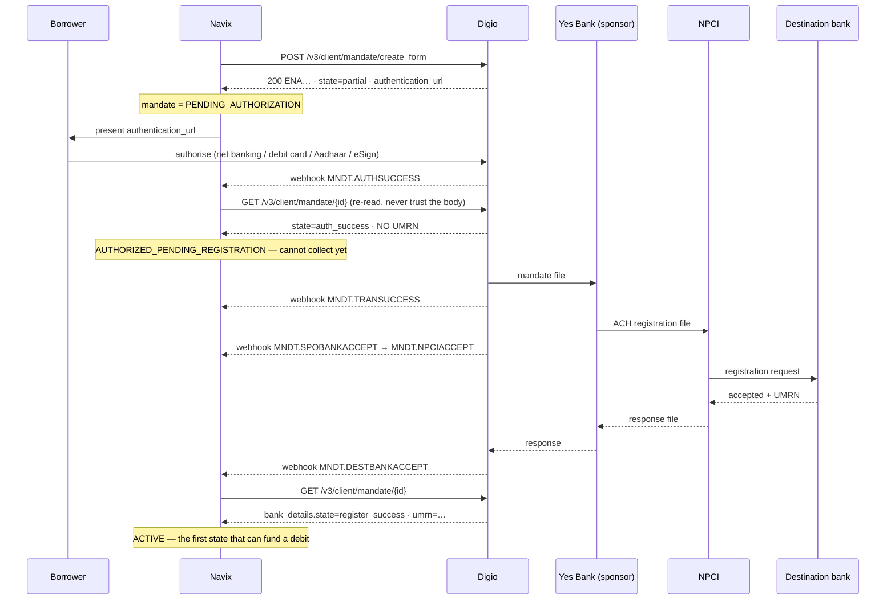
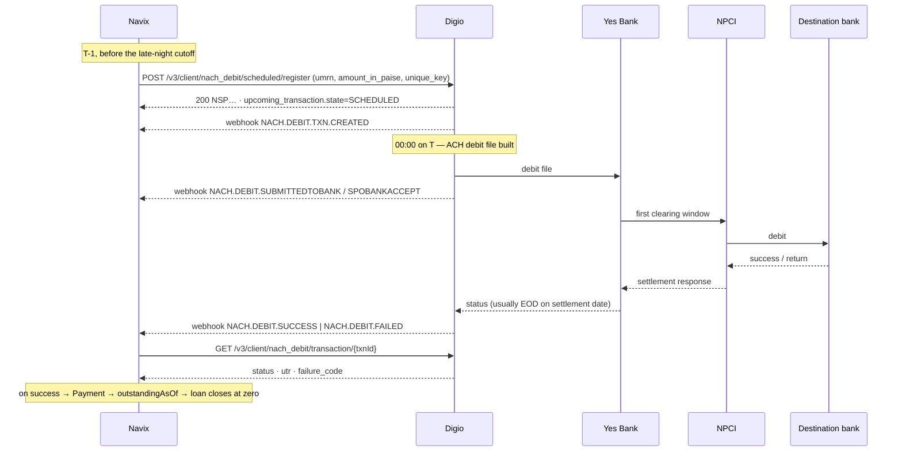
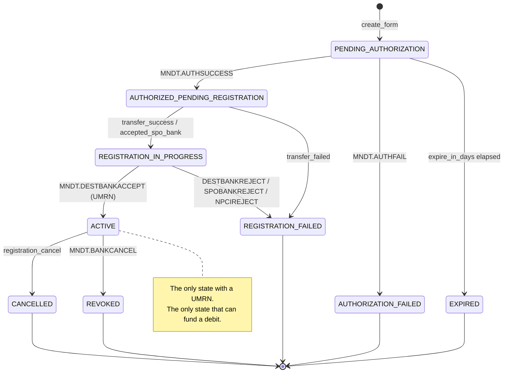
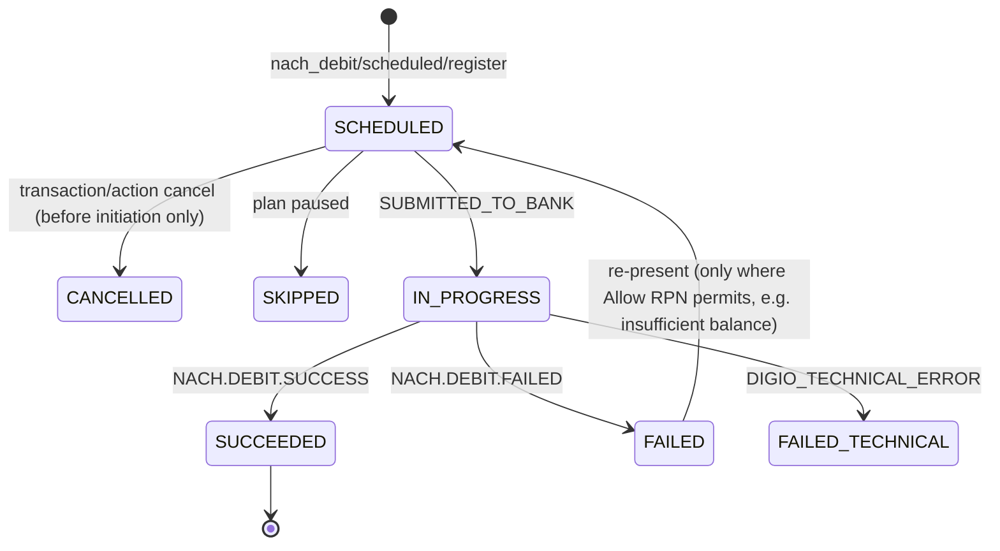

# Mandate lifecycle — diagrams

Derived from `02-` and `09-`. Digio states and events are VERIFIED; the Navix column is the proposal
in `08-`/`09-`.

## 1. Registration

**Days, not seconds**, from authorisation to UMRN. Everything before `MNDT.DESTBANKACCEPT` is
progress, not permission.

## 2. Debit

If T is an NPCI holiday, Digio reschedules to the next working day automatically — a later settlement
is **not** a failure.

## 3. Mandate states

Transitions are **monotonic** — a late out-of-order webhook must never move a mandate backwards
(`09-` §4). Any unrecognised Digio state goes to `UNKNOWN_QUARANTINE`, not to an exception.

## 4. Debit states

